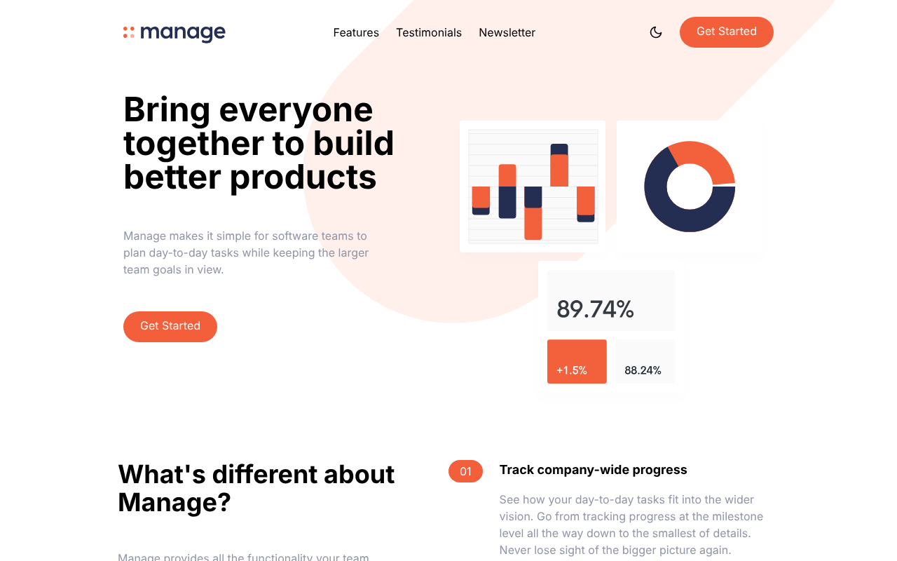
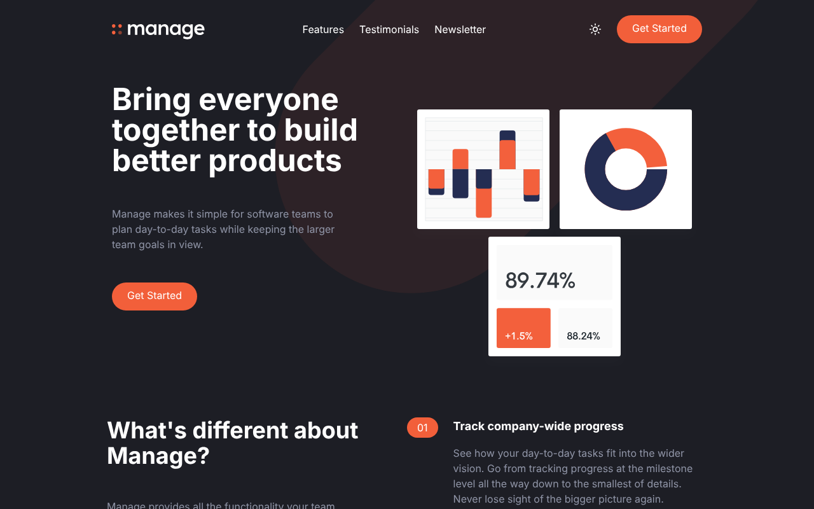
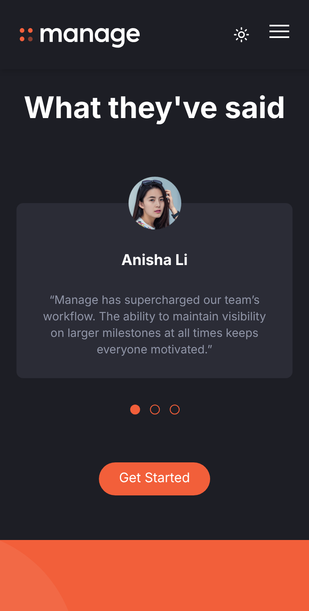

# Manage – Landing Page

Responsive landing page built with semantic HTML, Tailwind CSS and vanilla JavaScript, with dark mode, a swipeable mobile carousel and accessible form validation.

**Live demo:** https://loquacious-wisp-1db6d1.netlify.app/

| Light | Dark |
| --- | --- |
|  |  |

<p align="center">
  
</p>

## About

I built the first version of this page while following Traversy Media's Tailwind CSS course. The design comes from the [Frontend Mentor](https://www.frontendmentor.io/) "Manage landing page" challenge.

After finishing the course I went back to the project to fix its issues and extend it with the features below. I used an AI pair-programmer (Claude) for parts of this work. I reviewed, tested and committed every change myself and can walk through any part of the code.

## Features added after the course

- **Dark mode:** a toggle in the header that remembers the choice in `localStorage` and otherwise follows the OS setting (`prefers-color-scheme`). A small script in `<head>` applies the theme before the first paint, so the page never flashes the wrong theme.
- **Testimonials carousel on mobile:** the original showed only one of the three testimonials on mobile. Now they are all swipeable with **CSS scroll-snap** (no library), with dot navigation that follows the visible slide using an `IntersectionObserver`.
- **Reveal-on-scroll animations:** sections fade in once as they enter the viewport. The page is built with progressive enhancement: content stays visible if JavaScript fails or the user prefers reduced motion.
- **Sticky header and smooth scrolling:** the navigation links now lead to real sections. `scroll-padding` keeps headings from hiding under the sticky header.
- **Newsletter form validation:** custom, accessible error and success messages (`aria-live`, `aria-invalid`, `aria-describedby`) instead of the browser defaults. This is a front-end demo only. A real app would also validate on the server.

## Fixes and improvements

- **Accessibility:** meaningful `alt` text, `aria-label` on icon-only links and buttons, `aria-expanded` on the menu toggle, a labelled email input and a correct heading hierarchy
- **Bug fix:** the mobile menu rendered off-screen in current Chrome. An unused `self-end` class on an absolutely positioned element caused it, so I removed it.
- **Bug fix:** the newsletter input overflowed the screen on small phones because flex items don't shrink below their content width by default. I fixed it with `min-w-0`.
- **Mobile menu UX:** the menu now closes when you tap a link
- **Content fixes:** a duplicated section heading and a duplicated testimonial
- **Cleanup:** removed unused classes, no-op CSS rules and the obsolete IE meta tag, and added a meta description and favicon
- **Repository hygiene:** added `.gitignore` and removed `node_modules` from version control

## Built with

- HTML5
- Tailwind CSS v3 (class-based dark mode, custom theme colors)
- Vanilla JavaScript (`IntersectionObserver`, `matchMedia`, `localStorage`)
- Netlify (continuous deployment from `main`)

## Run locally

```bash
git clone https://github.com/koutsavlis/landing-page-tailwind.git
cd landing-page-tailwind
npm install
npm run watch   # development: rebuilds CSS on every change
npm run build   # one-off build
```

Tailwind compiles `input.css` into `css/main.css`. You can find the custom colors, breakpoints and dark mode setting in `tailwind.config.js`.
